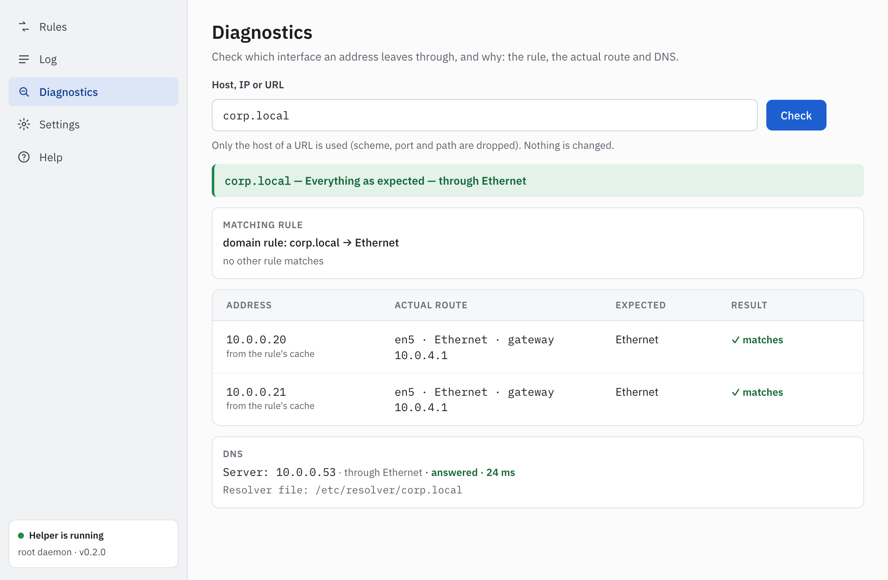

<p align="center">
  
</p>

<h1 align="center">RouteSwitch</h1>

<p align="center">
  <b>Send chosen IPs, subnets and domains through Ethernet or Wi‑Fi — straight from the macOS menu bar.</b>
</p>

<p align="center">
  <a href="https://github.com/jahongirsaidiy-max/route-switch/releases/latest"></a>
  <a href="LICENSE"></a>
  
  
</p>

<p align="center"><b>English</b> · <a href="README.ru.md">Русский</a></p>

RouteSwitch is a macOS menu bar app that sends traffic for the IPs, subnets and
domains you choose through a specific network interface — Ethernet or Wi‑Fi —
while everything else stays on the default route.

The typical setup: a Mac connected to an office network by cable and to the
internet over Wi‑Fi. Internal systems go through Ethernet, the rest goes
through Wi‑Fi, and you don't have to touch `route` by hand every time the
network changes.

<p align="center">
  
  &nbsp;
  
</p>
<p align="center">
  
</p>
<p align="center"><sub>Screenshots with sample data. The interface is available in English, Russian and Uzbek.</sub></p>

## Download

Get the latest version from **[GitHub Releases](https://github.com/jahongirsaidiy-max/route-switch/releases/latest)**:

| Your Mac | File |
|---|---|
| Apple silicon (M1 and later) | `RouteSwitch-<version>-arm64.dmg` |
| Intel | `RouteSwitch-<version>-x64.dmg` |

Each release also lists the SHA-256 checksum of every `.dmg`. To check a
download:

```bash
shasum -a 256 ~/Downloads/RouteSwitch-*.dmg   # must match the checksum on the release page
```

Requires macOS 13.5 (Ventura) or later and an administrator password, once,
to install the helper.

### First launch

1. Open the `.dmg` and drag **RouteSwitch** to **Applications**.
2. The build is not signed with a Developer ID and not notarized, so macOS
   blocks the first launch of a downloaded copy. Either right-click RouteSwitch
   in Applications, choose **Open**, then **Open** again (on macOS 15 and later:
   try to open it once, then **System Settings → Privacy & Security → Open
   Anyway**), or run
   `xattr -dr com.apple.quarantine /Applications/RouteSwitch.app` once.
   A copy you built yourself is not quarantined and opens directly.
3. RouteSwitch lives in the menu bar (no Dock icon). It shows
   "Helper is not installed"; click **Install the helper** and enter the
   administrator password once. The helper daemon then runs as root under
   `launchd` and keeps your routes even when the app is closed.

The app starts in the language of macOS (English, Russian, otherwise Uzbek);
change it in **Settings → Til / Язык / Language**.

### Updating from 0.1

Replace the app in Applications with the new one and open it. The 0.1 helper
speaks an older protocol, so RouteSwitch reports "Helper version does not
match": click **Reinstall the helper** and enter the administrator password.
Your rules are kept.

## Quick start

Route an office network and its internal domain through Ethernet, leave the
rest on Wi‑Fi:

1. Click the menu bar icon, then **Manage rules**.
2. Click **Add rule**:
   - type **Subnet**, address `10.0.0.0/8` (or the wildcard `10.*.*.*`),
     interface **Ethernet**;
   - optionally **Test** to see which interface the address uses right now;
   - **Save and apply**.
3. Add a second rule: type **Domain**, address `corp.local`, interface
   **Ethernet**. If internal names are only known to the office DNS, tick
   **Resolve through an internal DNS server** and enter its address, e.g.
   `10.0.0.53`.
4. Check it in **Diagnostics** (rules window): enter `corp.local` or an
   address to see the matching rule and the route each address takes. Or from
   Terminal:

   ```bash
   route -n get 10.1.2.3     # interface: the Ethernet device (e.g. en5)
   route -n get 1.1.1.1      # interface: the Wi-Fi device (e.g. en0)
   ```

Rules are re-applied automatically when the cable, the Wi‑Fi network or sleep
state changes. Use **Export** in the rules window to save them as JSON and
**Import** to load them on another Mac. **Help** in the rules window explains
every part of the app.

## Uninstall

1. **Settings → Remove the helper** removes the helper's routes and resolver
   files, the daemon and its files, including the rules it stores. The app
   keeps a backup of your rules and offers to restore them if you install the
   helper again.
2. Quit RouteSwitch and move it from Applications to the Trash.
3. To remove the backup and the app settings too, delete
   `~/Library/Application Support/RouteSwitch`.

## What it does

- **Three kinds of rules**
  - **IP** — a single host, e.g. `10.20.30.40`
  - **Subnet** — an IPv4 CIDR block, e.g. `10.0.0.0/8`, or a wildcard such as
    `10.*.*.*` (saved as `10.0.0.0/8`)
  - **Domain** — e.g. `corp.local`; its A records are resolved and applied as
    IP routes, then refreshed periodically
- **Per-rule interface** — each rule is bound to Ethernet or Wi‑Fi.
- **Scoped DNS for internal domains** — a per-domain resolver
  (`/etc/resolver/<domain>`) so internal names are resolved by the internal DNS
  server instead of the Wi‑Fi one.
- **Automatic re-apply** — rules are restored when a cable is plugged or
  unplugged, the Wi‑Fi network changes, or the Mac wakes from sleep.
- **Keeps working when the app is closed** — routing is handled by a background
  helper, so quitting the UI does not drop your routes.
- **Menu bar UI** — a compact status window, a rules manager, and an "add rule"
  form with a "test" button that shows which interface a target would use.
- **Diagnostics** — for a host, IP or URL: the matching rule and why, the
  route each address really takes compared with the expected one, and the DNS
  server in use. Read-only.
- **DNS server warnings** — when an internal DNS server is reached through the
  wrong interface, with a one-click rule suggestion.
- **Config import / export** as JSON, and an automatic **backup of your rules**
  that can be restored after reinstalling the helper.
- **Journal and settings** — an event log, launch at login, choice of the
  Ethernet adapter, and the Wi‑Fi service order.
- **English, Russian and Uzbek** UI, with built-in **Help** in each.

## How it works

RouteSwitch runs as two processes that talk only over a Unix domain socket:

```
┌─────────────────────────┐        JSON-lines over         ┌──────────────────────────┐
│ Electron app (user)     │  /var/run/routeswitch.sock     │ Helper daemon (root)     │
│ tray · windows · UI     │ ─────────────────────────────▶ │ config · routing engine  │
│ sends rules, shows state│ ◀───────────────────────────── │ network monitor · DNS    │
└─────────────────────────┘        state / log events      └──────────────────────────┘
                                                                        │
                                                          /sbin/route · /etc/resolver
```

- The **app** is only a UI and a client. It never runs `sudo` (apart from the
  one-time helper installation) and never writes the config file directly.
- The **helper** is the only process that touches the routing table and
  `/etc/resolver`. It stores the config, watches for network changes and keeps
  the system in sync with your rules.
- The routing engine is **declarative**: it computes the routes that should
  exist, compares them with the routes it has applied, and changes only the
  difference. The same reconcile step runs on startup, on config changes, on
  network changes and on a timer.
- Rules store an interface **role** (`ethernet` / `wifi`), not a device name
  like `en5`, so they keep working when you switch adapters.
- Only standard macOS tools are used (`route`, `networksetup`, `ipconfig`,
  `scutil`). No kernel extension and no Network Extension.

## Security model

The helper runs as root and accepts commands over a socket, so it is treated
as the most sensitive part of the project:

- **No shell.** System tools are invoked with `execFile`, absolute paths and
  argument arrays — never through a shell or string concatenation.
- **The helper re-validates everything** it receives, using the same schema as
  the app; IPs and CIDRs are parsed and normalised before use.
- **A fixed set of operations.** The protocol has no "run arbitrary command"
  method.
- **Default route protection.** `0.0.0.0/0`, `default`, loopback and multicast
  ranges are never added or removed, and the engine only deletes routes it
  added itself.
- **Resolver files are marked.** Only files carrying a `managed-by: routeswitch`
  marker are created, changed or removed; your own resolver files are left
  alone.
- **Restricted socket** (`0660`, group `staff`) and limits on the number of
  rules, IPs per domain and refresh rate.
- **Hardened Electron**: context isolation, sandboxed renderer, no remote
  content, strict CSP.
- **Clean uninstall** removes the helper, its routes and its resolver files.

## Tech stack

| Layer | Choice |
|---|---|
| Language | TypeScript, one npm-workspaces monorepo |
| App | Electron, React, Vite |
| Helper | Node.js daemon compiled to a single binary, run by `launchd` |
| IPC | Unix domain socket, JSON-lines |
| Validation | zod, shared between app and helper |
| Tests | vitest |

Layout:

```
packages/
  shared/   # types, zod schemas, IPC protocol, CIDR helpers
  helper/   # root daemon: engine, interface detection, routes, DNS, monitor
  app/      # Electron: main, preload, renderer (React UI)
scripts/    # helper install / uninstall
```

## Development

Requires Node.js 24 or newer and npm 11.

```bash
npm install        # install dependencies for all workspaces
npm run verify     # lint + typecheck + tests
```

The individual steps are also available as `npm run lint`,
`npm run typecheck` and `npm test`.

To run the Electron app:

```bash
npm run dev -w @routeswitch/app      # start the app with hot reload
npm run build -w @routeswitch/app    # production build into packages/app/out
npm run start -w @routeswitch/app    # build, then run the production build
```

### Helper binary and installation

```bash
npm run build:helper   # build/com.routeswitch.helper (universal: x86_64 + arm64)
```

The helper is bundled into one CommonJS file with esbuild and packed by
`@yao-pkg/pkg` in SEA mode: the official Node.js 24.21.0 binary (downloaded
from nodejs.org and checked against its `SHASUMS256.txt`) with the bundle
injected, one per architecture, joined with `lipo` and signed ad hoc.

Installing and removing change the system, so they run as root and only when
you start them:

```bash
RES="$(mktemp -d)"   # a fresh private directory, never a fixed /tmp name
cp build/com.routeswitch.helper packages/helper/launchd/com.routeswitch.helper.plist "$RES/"
sudo /bin/bash scripts/install-helper.sh "$RES"   # install or update, then start
rm -rf "$RES"
sudo /bin/bash scripts/uninstall.sh               # remove routes, resolver files, daemon, files
```

`install-helper.sh` keeps `config.json` across updates. `uninstall.sh` first
asks the helper to remove its routes and resolver files and stops without
deleting anything if that fails (`--force` goes on anyway). The paths both
scripts use are the ones in `packages/shared/src/paths.ts`.

### Building the .dmg

```bash
npm ci
npm run dist        # dist/RouteSwitch-<version>-arm64.dmg  (Intel Mac: npm run dist:x64)
```

Each `.dmg` holds one architecture: the app and the matching slice of the
helper. The packaged app refuses to start with any command-line argument
(`--remote-debugging-port`, `--proxy-server`, a file or URL, …) except the
`-psn_…` process number macOS itself may add, and has the Electron fuses
`RunAsNode`, `EnableNodeOptionsEnvironmentVariable` and
`EnableNodeCliInspectArguments` off, `OnlyLoadAppFromAsar` and asar integrity
on. For a release, start from a clean helper cache (`rm -rf ~/.pkg-cache/sea`)
so the Node.js archives are downloaded and checksum-verified again.

The app icon is `build/app-resources/icon.svg`, rendered to
`build/app-resources/icon.icns` (all iconset sizes, `iconutil`); electron-builder
takes it from there (`buildResources`).

### Signing and notarization (not set up)

Builds are signed ad hoc. To distribute to other Macs later:

1. Get a *Developer ID Application* certificate and export it as `.p12`.
   Never commit it: provide it only through the environment —
   `CSC_LINK` (path or base64) and `CSC_KEY_PASSWORD`.
2. In `electron-builder.yml`, drop `identity: '-'` (electron-builder then uses
   `CSC_LINK`), set `hardenedRuntime: true` and add entitlements. The helper
   binary must then be signed too (remove it from `signIgnore`) with
   `com.apple.security.cs.allow-jit` and
   `com.apple.security.cs.allow-unsigned-executable-memory`: it is Node.js.
3. Notarize with `mac.notarize: true` and `APPLE_API_KEY`, `APPLE_API_KEY_ID`,
   `APPLE_API_ISSUER` (or `APPLE_ID`, `APPLE_APP_SPECIFIC_PASSWORD`,
   `APPLE_TEAM_ID`) in the environment, e.g. as CI secrets.

## Roadmap

**Done in 0.1.0** (see [CHANGELOG](CHANGELOG.md)):

- Routing core — shared schemas, interface detection, declarative reconcile
  engine.
- Persistent root daemon — network monitoring, domain rules and scoped DNS,
  crash-safe cleanup, socket IPC, `launchd` installation.
- Electron app — tray, menu bar window, rules manager, helper install and
  removal, import/export, journal and settings, launch at login.
- Packaging — one `.dmg` per architecture, uninstall script.

**Done in 0.2.0:** English, Russian and Uzbek UI; IP wildcards; rules backup
and restore; Diagnostics; DNS server warnings; in-app Help.

**Planned:**

- **0.3.0** — wildcard domains (`*.example.com`) through a local DNS proxy.
- **0.4.0** — rule profiles, notifications, keeping Wi‑Fi first as the default
  route, and a command-line tool.

**Not planned:**

- IPv6 routes
- VPN (`utun`) interfaces
- Per-application routing — would need a Network Extension
- Mac App Store distribution

## License

[MIT](LICENSE) © 2026 RouteSwitch contributors
