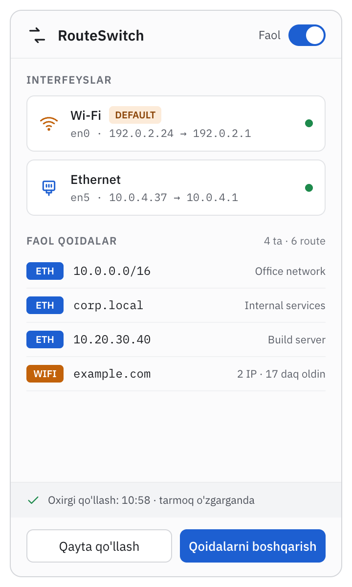
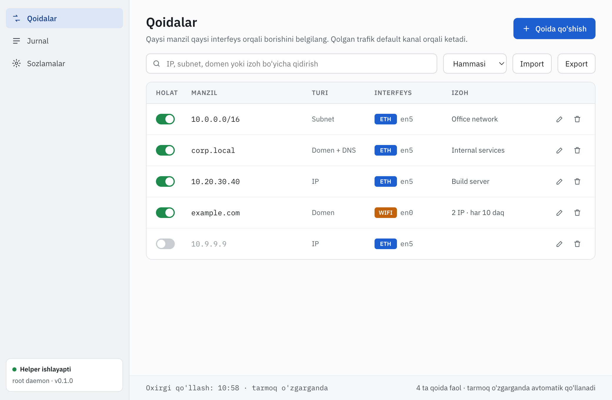

<p align="center">
  
</p>

<h1 align="center">RouteSwitch</h1>

<p align="center">
  <b>Направляйте выбранные IP, подсети и домены через Ethernet или Wi‑Fi — прямо из строки меню macOS.</b>
</p>

<p align="center">
  <a href="https://github.com/jahongirsaidiy-max/route-switch/releases/latest"></a>
  <a href="LICENSE"></a>
  
  
</p>

<p align="center"><a href="README.md">English</a> · <b>Русский</b></p>

RouteSwitch — приложение для строки меню macOS. Оно направляет трафик к
выбранным IP-адресам, подсетям и доменам через конкретный сетевой интерфейс —
Ethernet или Wi‑Fi, — а весь остальной трафик идёт по маршруту по умолчанию.

Типичный сценарий: Mac подключён к офисной сети кабелем, а к интернету — по
Wi‑Fi. Внутренние системы работают через Ethernet, всё остальное — через
Wi‑Fi, и не нужно вручную править маршруты командой `route` при каждой смене
сети.

<p align="center">
  
  &nbsp;
  
</p>
<p align="center"><sub>Скриншоты с примерными данными. Интерфейс приложения — на узбекском языке.</sub></p>

## Скачать

Последняя версия — на странице **[GitHub Releases](https://github.com/jahongirsaidiy-max/route-switch/releases/latest)**:

| Ваш Mac | Файл |
|---|---|
| Apple silicon (M1 и новее) | `RouteSwitch-<версия>-arm64.dmg` |
| Intel | `RouteSwitch-<версия>-x64.dmg` |

В каждом релизе также указана контрольная сумма SHA-256 каждого `.dmg`.
Проверить загрузку:

```bash
shasum -a 256 ~/Downloads/RouteSwitch-*.dmg   # должна совпасть с суммой на странице релиза
```

Нужны macOS 13.5 (Ventura) или новее и пароль администратора — один раз, для
установки helper.

### Первый запуск

1. Откройте `.dmg` и перетащите **RouteSwitch** в **Программы** (Applications).
2. Сборка не подписана сертификатом Developer ID и не нотаризована, поэтому
   macOS блокирует первый запуск скачанной копии. Либо щёлкните RouteSwitch в
   «Программах» правой кнопкой → **Открыть** → снова **Открыть** (в macOS 15 и
   новее: попробуйте открыть один раз, затем **Системные настройки →
   Конфиденциальность и безопасность → Всё равно открыть**), либо один раз
   выполните `xattr -dr com.apple.quarantine /Applications/RouteSwitch.app`.
   Копия, собранная вами самостоятельно, не помечается карантином и
   открывается сразу.
3. RouteSwitch работает в строке меню (без значка в Dock). Он покажет
   «Helper o'rnatilmagan» (*helper не установлен*); нажмите
   **Helper'ni o'rnatish** (*установить helper*) и один раз введите пароль
   администратора. После этого демон helper работает от root под `launchd` и
   сохраняет маршруты, даже когда приложение закрыто.

## Быстрый старт

Направим офисную сеть и её внутренний домен через Ethernet, а остальное
оставим на Wi‑Fi:

1. Щёлкните значок в строке меню, затем **Qoidalarni boshqarish**
   (*управление правилами*).
2. Нажмите **Qoida qo'shish** (*добавить правило*):
   - тип **Subnet**, адрес `10.0.0.0/8`, интерфейс **Ethernet**;
   - при желании **Sinab ko'rish** (*проверить*) — покажет, через какой
     интерфейс адрес идёт сейчас;
   - **Saqlash va qo'llash** (*сохранить и применить*).
3. Добавьте второе правило: тип **Domen** (*домен*), адрес `corp.local`,
   интерфейс **Ethernet**. Если внутренние имена знает только офисный DNS,
   отметьте **Ichki DNS server orqali resolve qilish** (*разрешать через
   внутренний DNS-сервер*) и укажите его адрес, например `10.0.0.53`.
4. Проверьте в Терминале:

   ```bash
   route -n get 10.1.2.3     # interface: устройство Ethernet (например, en5)
   route -n get 1.1.1.1      # interface: устройство Wi-Fi (например, en0)
   ```

Правила применяются заново автоматически при смене кабеля, сети Wi‑Fi или
выходе из сна. Кнопка **Export** в окне правил сохраняет их в JSON, а
**Import** загружает их на другом Mac.

## Удаление

> [!WARNING]
> **Удаление helper удаляет и ваши правила** — их хранит helper. Если хотите
> их сохранить, сначала нажмите **Export** в окне правил.

1. **Sozlamalar → Helper'ni o'chirish** (*Настройки → удалить helper*)
   убирает маршруты и файлы резолвера helper, демон и его файлы, включая
   правила.
2. Закройте RouteSwitch и перенесите его из «Программ» в Корзину.

## Возможности

- **Три типа правил**
  - **IP** — отдельный хост, например `10.20.30.40`
  - **Подсеть** — блок IPv4 в формате CIDR, например `10.0.0.0/8`
  - **Домен** — например `corp.local`; его A-записи резолвятся и применяются
    как IP-маршруты, затем периодически обновляются
- **Интерфейс для каждого правила** — правило привязывается к Ethernet или
  Wi‑Fi.
- **Scoped DNS для внутренних доменов** — отдельный резолвер для домена
  (`/etc/resolver/<домен>`), чтобы внутренние имена разрешал внутренний
  DNS-сервер, а не DNS сети Wi‑Fi.
- **Автоматическое повторное применение** — правила восстанавливаются при
  подключении или отключении кабеля, смене сети Wi‑Fi и выходе Mac из сна.
- **Работает при закрытом приложении** — маршрутизацией занимается фоновый
  helper, поэтому выход из интерфейса не сбрасывает маршруты.
- **Интерфейс в строке меню** — компактное окно состояния, менеджер правил и
  форма добавления правила с кнопкой «проверить», которая показывает, через
  какой интерфейс пойдёт трафик к адресу.
- **Импорт и экспорт конфигурации** в JSON.
- **Журнал и настройки** — журнал событий, запуск при входе в систему, выбор
  адаптера Ethernet и порядок сетевых служб для Wi‑Fi.

## Как это устроено

RouteSwitch состоит из двух процессов, которые общаются только через
Unix-сокет:

```
┌──────────────────────────┐      JSON-lines через         ┌──────────────────────────┐
│ Приложение Electron      │  /var/run/routeswitch.sock    │ Helper-демон (root)      │
│ (пользователь)           │ ────────────────────────────▶ │ конфиг · движок          │
│ трей · окна · интерфейс  │ ◀──────────────────────────── │ маршрутизации · монитор  │
└──────────────────────────┘     события state / log       └──────────────────────────┘
                                                                        │
                                                          /sbin/route · /etc/resolver
```

- **Приложение** — только интерфейс и клиент. Оно никогда не вызывает `sudo`
  (кроме однократной установки helper) и не пишет в файл конфигурации напрямую.
- **Helper** — единственный процесс, который изменяет таблицу маршрутизации и
  `/etc/resolver`. Он хранит конфигурацию, следит за изменениями сети и
  поддерживает систему в соответствии с правилами.
- Движок маршрутизации **декларативный**: он вычисляет, какие маршруты должны
  существовать, сравнивает их с уже применёнными и меняет только разницу. Один
  и тот же шаг согласования выполняется при запуске, при изменении
  конфигурации, при изменении сети и по таймеру.
- В правилах хранится **роль** интерфейса (`ethernet` / `wifi`), а не имя
  устройства вроде `en5`, поэтому правила продолжают работать при смене
  адаптера.
- Используются только штатные инструменты macOS (`route`, `networksetup`,
  `ipconfig`, `scutil`). Ни расширений ядра, ни Network Extension.

## Модель безопасности

Helper работает от имени root и принимает команды через сокет, поэтому это
самая чувствительная часть проекта:

- **Без оболочки.** Системные утилиты вызываются через `execFile` с абсолютными
  путями и массивом аргументов — никогда через shell или склейку строк.
- **Helper заново проверяет всё**, что получает, по той же схеме, что и
  приложение; IP-адреса и CIDR разбираются и нормализуются перед
  использованием.
- **Фиксированный набор операций.** В протоколе нет метода «выполнить
  произвольную команду».
- **Защита маршрута по умолчанию.** `0.0.0.0/0`, `default`, диапазоны loopback
  и multicast никогда не добавляются и не удаляются, а движок удаляет только те
  маршруты, которые добавил сам.
- **Файлы резолвера помечены.** Создаются, изменяются и удаляются только файлы
  с меткой `managed-by: routeswitch`; ваши собственные файлы резолвера не
  затрагиваются.
- **Ограниченный доступ к сокету** (`0660`, группа `staff`) и лимиты на число
  правил, IP-адресов на домен и частоту обновления.
- **Усиленная конфигурация Electron**: изоляция контекста, renderer в
  песочнице, без удалённого контента, строгий CSP.
- **Чистое удаление** убирает helper, его маршруты и файлы резолвера.

## Технологии

| Слой | Выбор |
|---|---|
| Язык | TypeScript, единый монорепозиторий на npm workspaces |
| Приложение | Electron, React, Vite |
| Helper | демон на Node.js, собранный в один бинарный файл, запускается через `launchd` |
| IPC | Unix-сокет, JSON-lines |
| Валидация | zod, общая для приложения и helper |
| Тесты | vitest |

Структура:

```
packages/
  shared/   # типы, схемы zod, протокол IPC, утилиты CIDR
  helper/   # root-демон: движок, определение интерфейсов, маршруты, DNS, монитор
  app/      # Electron: main, preload, renderer (интерфейс на React)
scripts/    # установка и удаление helper
```

## Разработка

Требуются Node.js 24 или новее и npm 11.

```bash
npm install        # установить зависимости всех workspace-пакетов
npm run verify     # линтер + проверка типов + тесты
```

Отдельные шаги также доступны как `npm run lint`, `npm run typecheck` и
`npm test`.

Запуск приложения Electron:

```bash
npm run dev -w @routeswitch/app      # запустить приложение с горячей перезагрузкой
npm run build -w @routeswitch/app    # production-сборка в packages/app/out
npm run start -w @routeswitch/app    # собрать и запустить production-сборку
```

### Бинарник helper и установка

```bash
npm run build:helper   # build/com.routeswitch.helper (universal: x86_64 + arm64)
```

Helper собирается esbuild в один CommonJS-файл и упаковывается
`@yao-pkg/pkg` в режиме SEA: официальный бинарник Node.js 24.21.0 (скачивается
с nodejs.org и проверяется по его `SHASUMS256.txt`) со встроенным бандлом, по
одному на архитектуру, затем объединяется через `lipo` и подписывается ad hoc.

Установка и удаление меняют систему, поэтому выполняются от root и только
когда вы сами их запускаете:

```bash
RES="$(mktemp -d)"   # новый приватный каталог, никогда не фиксированное имя в /tmp
cp build/com.routeswitch.helper packages/helper/launchd/com.routeswitch.helper.plist "$RES/"
sudo /bin/bash scripts/install-helper.sh "$RES"   # установить или обновить, затем запустить
rm -rf "$RES"
sudo /bin/bash scripts/uninstall.sh               # убрать маршруты, файлы resolver, демон, файлы
```

`install-helper.sh` сохраняет `config.json` при обновлении. `uninstall.sh`
сначала просит helper убрать свои маршруты и файлы резолвера и, если это не
удалось, останавливается, ничего не удаляя (`--force` продолжает всё равно).
Оба скрипта используют пути из `packages/shared/src/paths.ts`.

### Сборка .dmg

```bash
npm ci
npm run dist        # dist/RouteSwitch-<версия>-arm64.dmg  (Mac на Intel: npm run dist:x64)
```

Каждый `.dmg` содержит одну архитектуру: приложение и соответствующую часть
helper. Упакованное приложение отказывается запускаться с любым аргументом
командной строки (`--remote-debugging-port`, `--proxy-server`, файл или URL, …),
кроме номера процесса `-psn_…`, который может добавить сама macOS; Electron
fuses `RunAsNode`, `EnableNodeOptionsEnvironmentVariable` и
`EnableNodeCliInspectArguments` выключены, `OnlyLoadAppFromAsar` и проверка
целостности asar включены. Для релиза начинайте с чистого кэша helper
(`rm -rf ~/.pkg-cache/sea`), чтобы архивы Node.js были скачаны и проверены по
контрольным суммам заново.

Значок приложения — `build/app-resources/icon.svg`, отрисованный в
`build/app-resources/icon.icns` (все размеры iconset, `iconutil`);
electron-builder берёт его оттуда (`buildResources`).

### Подпись и нотаризация (не настроены)

Сборки подписываются ad hoc. Чтобы распространять на другие Mac:

1. Получите сертификат *Developer ID Application* и экспортируйте его в `.p12`.
   Никогда не коммитьте его: передавайте только через окружение —
   `CSC_LINK` (путь или base64) и `CSC_KEY_PASSWORD`.
2. В `electron-builder.yml` уберите `identity: '-'` (тогда electron-builder
   возьмёт `CSC_LINK`), включите `hardenedRuntime: true` и добавьте entitlements.
   Бинарник helper тоже нужно подписать (убрать его из `signIgnore`) с
   `com.apple.security.cs.allow-jit` и
   `com.apple.security.cs.allow-unsigned-executable-memory`: это Node.js.
3. Нотаризация: `mac.notarize: true` и `APPLE_API_KEY`, `APPLE_API_KEY_ID`,
   `APPLE_API_ISSUER` (или `APPLE_ID`, `APPLE_APP_SPECIFIC_PASSWORD`,
   `APPLE_TEAM_ID`) в окружении, например как секреты CI.

## План развития

**Готово в 0.1.0** (см. [CHANGELOG](CHANGELOG.md)):

- Ядро маршрутизации — общие схемы, определение интерфейсов, декларативный
  движок согласования.
- Постоянный root-демон — мониторинг сети, правила для доменов и scoped DNS,
  безопасная очистка после сбоев, IPC через сокет, установка через `launchd`.
- Приложение Electron — трей, окно в строке меню, менеджер правил, установка и
  удаление helper, импорт и экспорт, журнал и настройки, запуск при входе в
  систему.
- Упаковка — по одному `.dmg` на архитектуру, скрипт удаления.

**Дальше:** маршруты IPv6 (запланировано на 0.2).

**Не планируется в 0.1:**

- Wildcard-домены (`*.example.com`) — для них нужен DNS-прокси
- VPN-интерфейсы (`utun`)
- Маршрутизация по приложениям — для неё нужен Network Extension
- Публикация в Mac App Store

## Лицензия

[MIT](LICENSE) © 2026 RouteSwitch contributors
